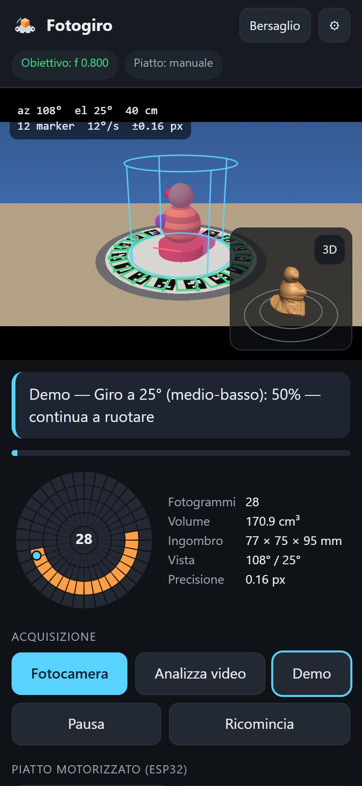
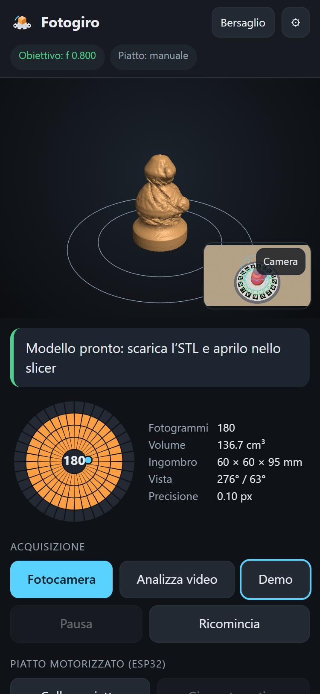

# Fotogiro

Scanner 3D a piatto rotante per smartphone. Metti l'oggetto sul piatto, il telefono
fermo su un supporto, fai girare il piatto: il solido si costruisce **mentre giri** e
alla fine scarichi un **file STL chiuso, in millimetri reali, pronto per lo slicer**.

Funziona come PWA (si installa dal browser, va anche offline), tutto sul telefono:
niente server, niente account, niente app da store.

**App:** <https://chopin94.github.io/fotogiro/> · **Bersaglio da stampare:** <https://chopin94.github.io/fotogiro/bersaglio.html>

<p>
  
  
</p>

## Cosa serve

- Un piatto rotante (per esempio stampato in 3D), **manuale o motorizzato** con ESP32 (vedi [`firmware/`](firmware/)).
- Il **bersaglio**: un cerchio di marker da stampare su A4 e incollare sul piatto.
- Uno smartphone su un supporto fisso. Android con Chrome per tutto (anche il Bluetooth);
  iPhone va bene per la scansione manuale e per il piatto in modalità autonoma.
- Uno sfondo uniforme dietro al piatto, di colore diverso dall'oggetto (un cartoncino basta).

## Come si usa

1. **Stampa il bersaglio** dalla pagina [Bersaglio](https://chopin94.github.io/fotogiro/bersaglio.html):
   scrivi il diametro del tuo piatto, il cerchio esce 2 mm più piccolo. Stampa al **100%**
   ("Dimensioni effettive") e controlla che il righello misuri 10 cm. Ritaglia e incolla.
2. Nell'app, in **Impostazioni**, metti il *Diametro bersaglio* scritto sul foglio.
3. Oggetto al centro, telefono fermo che inquadra tutto il foglio, poi **Fotocamera**.
4. Fai girare il piatto **piano o a scatti** (fermati un attimo ogni pochi gradi).
   I primi secondi servono a **calibrare l'obiettivo** (una volta sola per telefono).
5. Segui la guida: dopo un giro completo ti dice a che altezza spostare il telefono
   (consigliati 3 giri: ~20°, ~40°, ~60°). L'anello arancione mostra cosa hai già ripreso.
6. **Genera modello** → **Scarica STL** (o **Condividi** per mandarlo al PC).

In alternativa puoi registrare un video con la fotocamera del telefono e usare
**Analizza video**. **Demo** fa vedere tutto il processo con un piatto simulato.

Funziona anche **con il telefono in mano**, girando intorno al piatto fermo, e in
una stanza qualsiasi: se lo sfondo ha colori in comune con l'oggetto l'app scolpisce
solo dove vede il foglio e alla fine fa un **secondo passaggio** (quando conosce tutti
i colori dell'oggetto) per togliere il resto. In quel caso fai anche giri alti
(50–70°). Il pulsante **Flash** accende la luce del telefono (Chrome su Android).

### Con il piatto motorizzato

- **Android + Bluetooth:** *Collega piatto* → *Giro automatico*. L'app ruota di un passo,
  aspetta che il piatto sia fermo, scatta, e così via.
- **Senza Bluetooth (anche iPhone):** premi il tasto BOOT dell'ESP32: il piatto fa un giro
  a passi con le pause e l'app scatta da sola quando è fermo.

## Come funziona

```
fotogramma ─► marker del bersaglio ─► posa del telefono ─► silhouette ─► scultura del volume ─► mesh chiusa ─► STL
```

1. **Marker** (`markers.js`): soglia adattiva, contorni, quadrilateri, bordi rifiniti al
   sub-pixel e lettura di un codice 4×4 (dizionario generato con distanza minima 5).
2. **Posa** (`geometry.js`): omografia del piano del bersaglio, posa iniziale e
   ottimizzazione Levenberg–Marquardt. La **focale** si calibra da sola dalle prime viste
   (vincoli di Zhang + ricerca della focale con il minimo errore di riproiezione).
3. **Silhouette** (`segment.js`): sopra il foglio sappiamo esattamente cosa dovremmo vedere
   (l'abbiamo stampato noi), quindi tutto ciò che non coincide è l'oggetto; fuori dal
   foglio l'app impara i colori dello sfondo dalle zone dove l'oggetto non può stare.
4. **Scultura** (`carve.js`): una griglia di voxel nel cilindro sopra il bersaglio; ogni
   vista toglie ciò che cade fuori dalla silhouette. Ogni voxel tiene la distanza con segno
   dal contorno, con tolleranza a qualche vista sbagliata.
5. **Mesh** (`mesh.js`): marching tetrahedra (sempre chiusa, senza buchi), base piatta a
   z = 0, lisciatura di Taubin, esportazione STL/OBJ in millimetri.

Tutto il calcolo pesante gira in un Web Worker; l'anteprima 3D è WebGL2 senza librerie.

## Limiti (onesti)

- È un **visual hull**: le **concavità** che non si vedono di profilo (l'interno di una tazza,
  una fessura stretta) vengono riempite. Le forme convesse o "di profilo" vengono molto bene.
- La base è sempre **piatta** (l'oggetto appoggia sul foglio): ottimo per stampare.
- Oggetti **trasparenti o a specchio** e oggetti dello **stesso colore dello sfondo** danno
  silhouette sbagliate. Luce diffusa e sfondo a contrasto aiutano molto.
- Le **ombre** sul foglio vengono ignorate in automatico solo se l'oggetto è colorato:
  con oggetti grigi o bianchi un'ombra e l'oggetto si confondono.
- Il dettaglio è circa 1 mm (impostabile 0,7 mm). Per dettagli fini servirebbe la
  fotogrammetria "classica" su PC.

## Modalità debug

Accesa di default in questa fase di prova (si spegne in *Impostazioni → Prove*, si forza
con `?debug` nell'indirizzo). Mostra tempi di calcolo per fase, marker visti con il loro
numero, focale, copertura, log degli eventi, una **console per mandare comandi al piatto**
(`R 90`, `?`...) e permette di **salvare il fotogramma** corrente con tutti i dati di posa
(file `.json`) e di **esportare il log**: mandali pure quando qualcosa non va.

**Esporta scansione** salva in un file i fotogrammi chiave veri con pose, impostazioni e
log; **Riapri scansione** li ricalcola con le impostazioni attuali, senza rifare la
scansione (utile per tarare). Sul computer si può anche aprire `web/?debug&replay=<file>`.

### Supervisione dal PC (solo sviluppo)

```bash
python tools/supervisore.py
```

Serve il progetto in HTTPS sulla rete locale (certificato autofirmato: sul telefono
"Avanzate → Procedi") e stampa l'indirizzo da aprire sul telefono,
`https://<ip-del-pc>:8443/web/?debug&supervisore`. Durante la scansione il telefono
invia fotogrammi chiave, sagome, pose, log e STL in `.supervisore/<data-ora>/` sul PC.

## Struttura

```
web/                PWA pubblicata su GitHub Pages
  index.html        app
  bersaglio.html    stampa del bersaglio (SVG a dimensione reale e PDF)
  js/               moduli ES senza dipendenze
  sw.js             cache offline (rigenerato dalla Action)
firmware/           ESP32: Bluetooth LE + motore passo-passo
bersaglio/          PDF già pronti
tests/              test (Node e browser) su scene sintetiche
tools/build-sw.mjs  elenco dei file in cache e versione
```

## Sviluppo

```bash
node --test
```

I test generano immagini sintetiche del piatto con un oggetto di forma nota e verificano
marker, posa, focale, silhouette, scultura e la pipeline completa fino all'STL chiuso.
Gli stessi test girano nel browser aprendo `tests/run.html` da un server locale
(per esempio `python -m http.server` nella cartella del progetto); `tests/debug.html`
confronta la silhouette calcolata con quella vera.

## Pubblicazione

Una volta caricato il repository su GitHub: *Settings → Pages → Source: GitHub Actions*.
A ogni push su `main` la Action esegue i test e, solo se passano, pubblica `web/`.
I telefoni con l'app installata vedono "Nuova versione disponibile".

## Licenza

MIT
